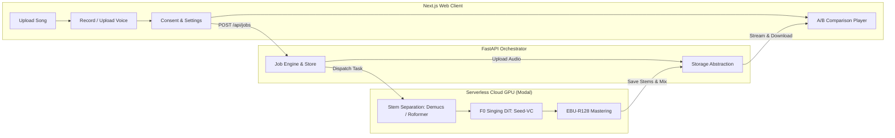

# VocalMorph: Zero-Shot Singing Voice Conversion Website

> Transform any song into your own singing voice using zero-shot diffusion voice conversion (Seed-VC) and deep stem separation. Designed for CPU-only client machines with serverless cloud GPU offloading.

---

## 1. Overview & Architecture

VocalMorph takes an original song (MP3/WAV/FLAC) and a brief 10–30 second voice reference clip from a user, isolates the lead vocal track, converts the vocal timbre to match the user's voice while strictly tracking pitch contour and phrasing, and remixes the new vocal stem with the original instrumental backing at studio broadcast loudness (-14 LUFS).



---

## 2. Key Features

- **Zero-Shot Voice Conversion:** Powered by **Seed-VC** (F0-conditioned Diffusion Transformer). No per-user dataset collection or model training required.
- **State-of-the-Art Stem Separation:** Separates lead vocals using Meta’s **Demucs (`htdemucs`)** or **BS-RoFormer** via `audio-separator` for minimal bleed.
- **Audio Engineering & Mastering:** Chunked inference with unity-gain linear crossfading, vocal de-essing, dynamic leveling, and EBU R128 loudness normalization to **-14.0 LUFS**.
- **CPU-Only Local Development (`USE_MOCK_GPU=true`):** Develop and test the full web interface, audio recorder, and API on your laptop with zero cloud costs and zero GPU requirements.
- **Serverless Cloud GPU (Modal):** Scale-to-zero compute with persistent model caching to eliminate cold-start download delays.
- **Privacy & Safety First:** Mandatory consent tracking (IP hash + timestamp), automated 24-hour file purging, on-demand data wipe, and AI metadata disclosure tags.

---

## 3. Technology Stack

| Layer | Technologies |
| :--- | :--- |
| **Frontend** | Next.js 14 (App Router), TypeScript, Tailwind CSS, Web Audio API |
| **Backend API** | Python 3.11, FastAPI, Pydantic v2, SQLModel (SQLite / Postgres) |
| **Cloud GPU** | Modal Serverless Compute (NVIDIA A10G / T4 GPU) |
| **Audio Processing** | FFmpeg, Demucs, BS-RoFormer, Seed-VC (DiT), RMVPE, CAMPPlus, pyloudnorm |
| **Prototypes** | Google Colab (`notebooks/phase0_prototype.ipynb`) |

---

## 4. Quickstart Guide

### 4.1 Running the GPU Backend on Google Colab (Free T4 + ngrok)
1. Open [`notebooks/singing_voice_conversion_colab.ipynb`](notebooks/singing_voice_conversion_colab.ipynb) in Google Colab.
2. Select runtime: **T4 GPU** (`Runtime -> Change runtime type -> T4 GPU`).
3. Paste your free [ngrok authtoken](https://dashboard.ngrok.com/get-started/your-authtoken) in Section 7 and run all cells.
4. Copy the printed `https://xxxx.ngrok-free.app` URL into `frontend/.env.local`:
   ```ini
   NEXT_PUBLIC_API_URL=https://xxxx.ngrok-free.app
   ```
5. Run your Next.js frontend locally (`npm run dev`)—all ML inference runs on Google Colab for free!

### 4.2 Running the Phase 0 Prototype on Google Colab (Free GPU)
1. Open [`notebooks/phase0_prototype.ipynb`](notebooks/phase0_prototype.ipynb) in Google Colab.
2. Select runtime type: **T4 GPU** (`Runtime -> Change runtime type -> T4 GPU`).
3. Run the cells sequentially to test stem separation (Demucs vs Roformer), Seed-VC singing voice conversion, and audio mastering.

### 4.3 Running the Full-Stack App Locally (CPU Mock Mode)
You do not need a GPU to develop or run the application locally!

1. **Clone repository & configure environment:**
   ```bash
   cp .env.example .env
   # Ensure USE_MOCK_GPU=true in .env
   ```
2. **Start Backend API (Terminal 1):**
   ```bash
   cd backend
   python -m venv venv
   # Windows: .\venv\Scripts\Activate.ps1 | Linux/Mac: source venv/bin/activate
   pip install -r requirements.txt
   uvicorn app.main:app --reload --port 8000
   ```
3. **Start Frontend (Terminal 2):**
   ```bash
   cd frontend
   npm install
   npm run dev
   ```
4. Open `http://localhost:3000` in your web browser.

---

## 5. Phased Roadmap & Project Status

- [x] **Documentation & Architecture Suite** (`docs/`)
- [x] **Phase 0: Prototype Notebook** (`notebooks/phase0_prototype.ipynb`)
- [ ] **Phase 1: Worker Package & Modal Cloud GPU CLI**
- [ ] **Phase 2: FastAPI Backend, JobStore & Storage Abstraction**
- [ ] **Phase 3: Next.js Frontend Web Application & A/B Player**
- [ ] **Phase 4: Hardening, Crossfade Optimization & Benchmarking**
- [ ] **Phase 5: Production Deployment & Showcase**
- [ ] **Phase 6: [ON HOLD] RVC High-Quality Engine** (See `docs/rvc-future.md`)

---

## 6. Ethical AI, Copyright & Legal Notice

- **Voice Ownership & Consent:** This application is built strictly for personal, non-commercial experimentation and educational research. Users must certify that voice samples submitted are their own or used with explicit authorization.
- **Copyrighted Songs:** Processing of copyrighted musical compositions should only be performed for private educational analysis.
- **AI Attribution:** Converted audio exports embed metadata tags identifying the audio as synthesized via Seed-VC.
- **Data Retention:** All uploads and synthesized stems are permanently deleted after 24 hours.

---

## 7. Open Source Licensing

This repository integrates open-source components under their respective licenses:
- **Seed-VC:** GNU General Public License v3.0 (GPL-3.0)
- **Demucs:** MIT License
- **audio-separator:** MIT License
- **CAMPPlus:** Apache 2.0
- **RMVPE:** MIT License
- **FastAPI / Next.js / Tailwind:** MIT License

*For a detailed licensing breakdown, see [docs/licenses.md](docs/licenses.md).*
