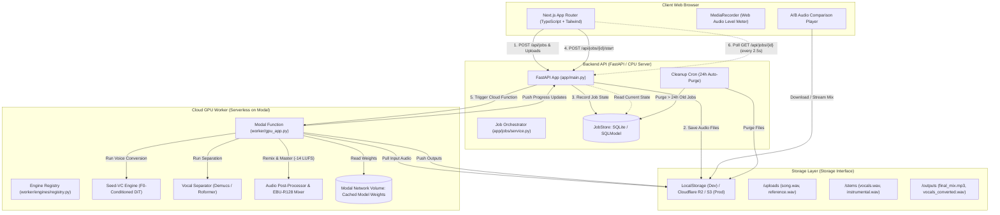

# System Architecture & Technical Specification
## Singing Voice Conversion Website (Seed-VC MVP)

---

### 1. System Architecture Diagram



---

### 2. Technology Stack & Key Decisions

| Tier | Technology | Purpose & Rationale |
| :--- | :--- | :--- |
| **Frontend** | Next.js 14+ (App Router), TypeScript, Tailwind CSS | High developer ergonomics, built-in API proxying, type safety, modular component structure. |
| **Audio Capture** | Web Audio API + MediaRecorder | Client-side audio recording without external plugins; provides raw PCM for live canvas volume metering. |
| **Backend API** | Python 3.11, FastAPI, Pydantic v2, Uvicorn | High-performance asynchronous API, automatic OpenAPI validation, native Python integration with audio and ML tooling. |
| **State & Database** | SQLModel (SQLAlchemy + Pydantic) on SQLite | Zero-infrastructure relational storage for local development; clean repository abstraction allows seamless drop-in of PostgreSQL later. |
| **Storage Abstraction** | Custom `StorageBackend` interface | Implements `LocalStorageBackend` for local disk dev and `S3StorageBackend` (Cloudflare R2 / AWS S3) for production via signed URLs. |
| **Cloud GPU Worker** | Modal (Serverless Python runtime) | Pay-per-second serverless execution, fast cold starts, native PyTorch CUDA 12 support, scales to zero when idle (ideal for student budgets). |
| **Voice Conversion** | Seed-VC (Diffusion Transformer) | Zero-shot singing conversion, F0-pitch conditioned, high fidelity 44.1 kHz output without per-user model training. |
| **Stem Separation** | Demucs (`htdemucs`) / python-audio-separator | Clean separation of lead vocals and instrumental accompaniment; MIT licensed. |
| **Audio Processing** | `ffmpeg`, `soundfile`, `librosa`, `pyloudnorm`, `scipy` | Format decoding, resampling, silence trimming, equal-power chunk crossfading, true-peak limiting, and -14 LUFS loudness mastering. |

---

### 3. Repository Folder Structure

```
singing-voice-conversion/
├── .env.example                    # Template for environment configuration
├── .gitignore                      # Git ignore for virtualenvs, node_modules, temp audio
├── README.md                       # High-level overview, quickstart, architecture summary
├── package.json                    # Workspace root scripts (optional runner)
│
├── frontend/                       # Next.js 14 Web Application
│   ├── app/
│   │   ├── layout.tsx              # Root HTML & metadata shell
│   │   ├── page.tsx                # Main conversion single-page workflow
│   │   └── globals.css             # Tailwind base & custom styles
│   ├── components/                 # UI Components
│   │   ├── AudioRecorder.tsx       # In-browser microphone recorder & meter
│   │   ├── AudioUploader.tsx       # Song drag-and-drop selector
│   │   ├── ABPlayer.tsx            # Synchronized A/B comparison audio player
│   │   ├── ProgressCard.tsx        # Pipeline stage progress indicator
│   │   └── SettingsModal.tsx       # Semitone, quality, format settings
│   ├── hooks/                      # Custom React hooks (useAudioRecorder, useJobPoll)
│   ├── lib/                        # Client utilities and API client
│   ├── public/                     # Static assets (favicons, demo sample audio)
│   ├── tailwind.config.js          # Tailwind CSS theme configuration
│   ├── tsconfig.json               # Strict TypeScript configuration
│   └── package.json                # Frontend dependencies
│
├── backend/                        # FastAPI Application & Orchestrator
│   ├── app/
│   │   ├── main.py                 # FastAPI application factory, middleware, CORS
│   │   ├── config.py               # Pydantic BaseSettings (.env loading)
│   │   ├── api/
│   │   │   ├── routes_jobs.py      # Job CRUD, start, status, download endpoints
│   │   │   └── routes_health.py    # Health check & system status
│   │   ├── core/
│   │   │   ├── exceptions.py       # Custom domain exceptions
│   │   │   ├── security.py         # IP hashing, sanitization helpers
│   │   │   └── audio_utils.py      # ffprobe inspection, validation helpers
│   │   ├── jobs/
│   │   │   ├── service.py          # Job lifecycle orchestration
│   │   │   ├── store.py            # JobStore interface & SQLite implementation
│   │   │   └── cleanup.py          # 24h TTL background auto-purge task
│   │   ├── schemas/
│   │   │   ├── job.py              # Pydantic DTOs (JobCreate, JobResponse, JobStatus)
│   │   │   └── error.py            # Standardized API error responses
│   │   └── storage/
│   │       ├── base.py             # Abstract StorageBackend interface
│   │       ├── local.py            # Local disk storage implementation
│   │       └── s3.py               # S3 / Cloudflare R2 implementation
│   ├── requirements.txt            # Pinned backend dependencies
│   └── tests/                      # Backend unit & integration tests
│
├── worker/                         # GPU Worker & ML Inference Pipelines
│   ├── gpu_app.py                  # Modal application definition & webhooks
│   ├── cache_weights.py            # Script to populate Modal volume with model weights
│   ├── pipeline/
│   │   ├── runner.py               # Main pipeline coordinator (stages 1-7)
│   │   ├── separation.py           # Vocal & instrumental isolation (Demucs)
│   │   ├── chunking.py             # Audio chunking with overlap & crossfade
│   │   ├── postprocess.py          # Vocal EQ, de-essing, ambiance matching
│   │   └── mastering.py            # Summing, limiting, and EBU-R128 loudness matching
│   ├── engines/
│   │   ├── base.py                 # VoiceConverter abstract base class
│   │   ├── registry.py             # Engine registry mapping engine_name -> converter
│   │   ├── seed_vc.py              # Seed-VC singing engine implementation
│   │   └── rvc_stub.py             # RVC placeholder (raises 400 "on hold")
│   ├── mock.py                     # Mock converter for local zero-GPU development
│   └── requirements-worker.txt     # GPU worker dependencies (PyTorch, torchaudio, etc.)
│
├── notebooks/                      # Exploratory & Prototype Notebooks
│   └── phase0_prototype.ipynb      # Google Colab / Kaggle verification notebook
│
├── scripts/                        # Utility & Evaluation Scripts
│   ├── eval/
│   │   ├── run_eval.py             # Benchmark runner (timing, latency, cost estimate)
│   │   └── mos_template.csv        # Subjective listening test rating template
│   └── dev_run.py                  # Single-command dev launcher for local testing
│
└── docs/                           # Documentation Suite
    ├── prd.md                      # Product requirements document
    ├── design.md                   # UI/UX & screens specification
    ├── architecture.md             # System architecture & API spec (this file)
    ├── instruction.md              # Setup & execution instructions
    ├── phases.md                   # Phased delivery plan & acceptance gates
    ├── rules.md                    # Engineering rules & development guardrails
    ├── rvc-future.md               # RVC integration architecture (future scope)
    └── licenses.md                 # Dependency licensing & compliance matrix
```

---

### 4. GPU Worker Pipeline Architecture (Stages 1 to 7)

```
[Raw Song] + [Voice Sample] + [Options]
   │
   ├──▶ Stage 1: VALIDATE
   │      - Verify file type (audio/wav, audio/mpeg, etc.) via ffprobe
   │      - Verify duration: Song <= 360s, Sample 5s - 60s
   │      - Reject corrupt files with explicit error
   │
   ├──▶ Stage 2: NORMALIZE
   │      - Resample to 44.1 kHz
   │      - Convert song to stereo; convert sample to mono
   │      - Strip leading and trailing silence (< -40 dBFS) from sample
   │      - Warn if sample RMS is clipping (> -1 dBFS) or too quiet (< -30 dBFS)
   │
   ├──▶ Stage 3: SEPARATE (Demucs htdemucs)
   │      - Separate song into Vocals stem and Instrumental stem
   │      - Stash instrumental stem at 44.1 kHz stereo for final mix
   │
   ├──▶ Stage 4: CONVERT (Seed-VC Singing Engine)
   │      - Extract reference speaker embedding (CAMPPlus) from voice sample
   │      - Extract F0 pitch contour (RMVPE) from original vocal stem
   │      - Apply semitone shift if specified (F0 * 2^(shift / 12))
   │      - Chunk vocal stem into 15s segments with 2s overlap to avoid OOM
   │      - Run Seed-VC DiT diffusion transformer (f0_condition=True, cfg=0.7)
   │      - Recombine chunks using linear crossfade: w1(t) + w2(t) = 1
   │
   ├──▶ Stage 5: POST-PROCESS
   │      - Light de-esser (attenuate harsh sibilance at 5 kHz - 8 kHz)
   │      - High-pass filter at 75 Hz (remove rumble)
   │      - Subtle room ambiance / matching reverb
   │
   ├──▶ Stage 6: MIX & MASTER
   │      - Sum converted vocal stem and original instrumental stem
   │      - Dynamic vocal ride to prevent masking
   │      - True-peak soft limiter (ceiling at -1.0 dBTP)
   │      - Normalize final mix to -14.0 LUFS integrated loudness (pyloudnorm)
   │
   └──▶ Stage 7: EXPORT & LOG
          - Encode final_mix.mp3 (320 kbps), final_mix.wav, and vocals_converted.wav
          - Embed ID3 metadata tags (AI disclosure)
          - Log precise stage elapsed durations for project report
          - Push artifacts to storage and mark job DONE
```

---

### 5. Engine Abstraction Architecture

To ensure strict separation of concerns and allow seamless future addition of RVC without refactoring, all voice conversion engines inherit from `VoiceConverter`:

```python
# worker/engines/base.py
from abc import ABC, abstractmethod
from typing import Any, Dict, Optional

class VoiceConverter(ABC):
    name: str
    requires_training: bool

    @abstractmethod
    def prepare(self, reference_audio_path: str, options: Dict[str, Any]) -> Any:
        """
        Prepares the reference voice representation.
        For Seed-VC: Extracts and caches the speaker embedding and mel-spectrogram.
        For future RVC: Validates/loads the trained checkpoint and faiss index.
        """
        pass

    @abstractmethod
    def convert(
        self,
        source_vocals_path: str,
        handle: Any,
        options: Dict[str, Any],
        progress_callback: Optional[callable] = None
    ) -> str:
        """
        Executes voice conversion on the source vocal audio stem.
        Returns the file path of the converted vocals.
        """
        pass
```

#### Engine Registry & Factory
```python
# worker/engines/registry.py
from typing import Dict, Type
from worker.engines.base import VoiceConverter
from worker.engines.seed_vc import SeedVCConverter

engine_registry: Dict[str, Type[VoiceConverter]] = {
    "seed-vc": SeedVCConverter,
}

def get_engine(name: str) -> VoiceConverter:
    if name == "rvc":
        raise ValueError("The RVC engine is currently on hold. Use 'seed-vc'.")
    if name not in engine_registry:
        raise ValueError(f"Unknown engine: '{name}'. Available: {list(engine_registry.keys())}")
    return engine_registry[name]()
```

---

### 6. Job Lifecycle States & State Transitions

```
[CREATED] ──▶ [UPLOADED] ──▶ [QUEUED] ──▶ [SEPARATING] ──▶ [CONVERTING] ──▶ [MIXING] ──▶ [DONE]
    │             │             │              │               │             │
    ▼             ▼             ▼              ▼               ▼             ▼
[FAILED] <───────────────────────────────────────────────────────────────────┘
    │
    ▼ (after 24 hours or user delete)
[EXPIRED / PURGED]
```

| State | Progress Range | Meaning & UI Feedback |
| :--- | :--- | :--- |
| `CREATED` | 0% | Job record initialized; pre-signed upload URLs generated. |
| `UPLOADED` | 5% | Client has uploaded both song and voice reference files. |
| `QUEUED` | 10% | Consent verified; job enqueued to Cloud GPU worker. |
| `SEPARATING` | 15% - 35% | Demucs is separating song into lead vocals and instrumental. |
| `CONVERTING` | 35% - 85% | Seed-VC is running F0-conditioned diffusion on vocal chunks. |
| `MIXING` | 85% - 95% | Vocals post-processed, aligned, remixed, and normalized to -14 LUFS. |
| `DONE` | 100% | Final mix & stems exported and ready for download / playback. |
| `FAILED` | 0% - 100% | Unrecoverable error encountered; `error_code` and message returned. |
| `EXPIRED` | - | 24-hour retention exceeded; all underlying files deleted. |

---

### 7. REST API Specification

#### Base URL: `/api`

#### 7.1 Create Job
- **`POST /api/jobs`**
- **Description:** Initializes a job record and returns upload handles.
- **Request Body (JSON):**
  ```json
  {
    "engine": "seed-vc",
    "song_filename": "yesterday.mp3",
    "sample_filename": "voice_sample.wav",
    "options": {
      "semitone_shift": 0,
      "diffusion_steps": 35,
      "output_format": "mp3"
    }
  }
  ```
- **Response `201 Created`:**
  ```json
  {
    "job_id": "550e8400-e29b-41d4-a716-446655440000",
    "status": "CREATED",
    "upload_song_url": "/api/jobs/550e8400-e29b-41d4-a716-446655440000/upload/song",
    "upload_sample_url": "/api/jobs/550e8400-e29b-41d4-a716-446655440000/upload/sample",
    "created_at": "2026-10-26T12:00:00Z"
  }
  ```
- *(Note: In local dev, multipart upload can also be accepted directly in one call to simplify testing).*

#### 7.2 Upload Audio Files (Local Dev / Direct API)
- **`POST /api/jobs/{id}/upload/{file_type}`** (`file_type`: `song` or `sample`)
- **Content-Type:** `multipart/form-data`
- **Response `200 OK`:**
  ```json
  {
    "job_id": "550e8400-e29b-41d4-a716-446655440000",
    "file_type": "song",
    "received_bytes": 8452100,
    "status": "UPLOADED"
  }
  ```

#### 7.3 Start Processing Job
- **`POST /api/jobs/{id}/start`**
- **Description:** Validates mandatory consent, locks job settings, and dispatches task to the GPU worker.
- **Request Body (JSON):**
  ```json
  {
    "consent": true
  }
  ```
- **Response `202 Accepted`:**
  ```json
  {
    "job_id": "550e8400-e29b-41d4-a716-446655440000",
    "status": "QUEUED",
    "message": "Conversion enqueued to GPU worker."
  }
  ```
- **Error `400 Bad Request`:** If `consent` is `false` or missing files.

#### 7.4 Get Job Status
- **`GET /api/jobs/{id}`**
- **Description:** Polled every 2.5 seconds by frontend.
- **Response `200 OK` (In Progress):**
  ```json
  {
    "job_id": "550e8400-e29b-41d4-a716-446655440000",
    "status": "CONVERTING",
    "progress": 55,
    "message": "Running diffusion on vocal chunk 3/5...",
    "elapsed_seconds": 42.1,
    "eta_seconds": 35.0,
    "error": null,
    "outputs": null
  }
  ```
- **Response `200 OK` (Completed):**
  ```json
  {
    "job_id": "550e8400-e29b-41d4-a716-446655440000",
    "status": "DONE",
    "progress": 100,
    "message": "Conversion completed successfully.",
    "elapsed_seconds": 88.4,
    "eta_seconds": 0.0,
    "error": null,
    "outputs": {
      "original_song_url": "/api/jobs/550e8400-e29b-41d4-a716-446655440000/download/original",
      "final_mix_url": "/api/jobs/550e8400-e29b-41d4-a716-446655440000/download/final_mix",
      "vocals_url": "/api/jobs/550e8400-e29b-41d4-a716-446655440000/download/vocals",
      "expires_at": "2026-10-27T12:00:00Z"
    }
  }
  ```

#### 7.5 Download Artifacts
- **`GET /api/jobs/{id}/download/{kind}`**
- **Allowed values for `kind`:** `original`, `final_mix`, `vocals`
- **Response:** File stream (audio/mpeg or audio/wav) with `Content-Disposition: attachment`.

#### 7.6 Delete Job Data
- **`DELETE /api/jobs/{id}`**
- **Description:** Immediately wipes all uploaded audio and rendered files from disk/storage and marks the job record as purged.
- **Response `200 OK`:**
  ```json
  {
    "job_id": "550e8400-e29b-41d4-a716-446655440000",
    "deleted": true,
    "message": "All user files permanently removed."
  }
  ```

#### 7.7 System Health
- **`GET /api/health`**
- **Response `200 OK`:**
  ```json
  {
    "status": "healthy",
    "version": "0.1.0",
    "gpu_mode": "mock", // or "modal"
    "storage_backend": "local" // or "s3"
  }
  ```

#### 7.8 Standard Error Response Format
```json
{
  "code": "FILE_TOO_LONG",
  "message": "The uploaded song exceeds the maximum limit of 6 minutes.",
  "details": {
    "detected_duration_seconds": 435.2,
    "max_allowed_seconds": 360.0
  }
}
```

---

### 8. Security, Rate Limiting & CORS
- **CORS:** Restricted to `CLIENT_ORIGIN` (e.g., `http://localhost:3000` in dev; production domain in prod).
- **Rate Limiting:** Sliding-window limiter: maximum 5 conversion starts per IP per hour to protect cloud GPU compute quotas.
- **File Validation:** Files undergo magic byte detection and `ffprobe` header inspection before being passed to ffmpeg or any ML model.
- **Safe Execution:** All `ffmpeg` operations use explicit array argument passing via `subprocess.run(..., shell=False)` to prevent command injection.
