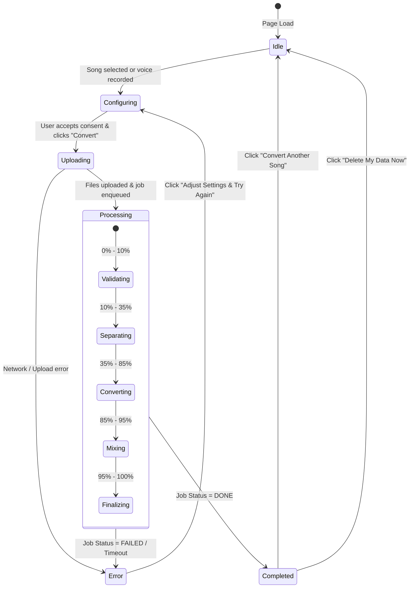

# Design & UI/UX Specification
## Singing Voice Conversion Website (Seed-VC MVP)

---

### 1. UI/UX Principles & Aesthetics
- **Single-Page Progressive Flow:** The entire user journey unfolds intuitively on a single page with distinct progressive stages. Users are never disoriented by complex multi-page routing.
- **Dark-First Modern Theme:** Styled with Tailwind CSS using a deep slate background (`#0b0f17`), crisp white typography, and electric purple/indigo accents (`#6366f1` / `#8b5cf6`) to mirror modern digital audio workstations (DAWs).
- **Audio Feedback & Confidence:** File inputs immediately give visual feedback (detected duration, filename, file size, format). The voice recorder provides a live audio level meter.
- **A/B Instant Comparison:** Results screen prioritizes direct comparison with zero-delay hot-swapping between the original lead vocal and the converted vocal mix.
- **Mobile-Responsive & Accessible:** Fully responsive flex/grid layouts, high-contrast text ratios conforming to WCAG 2.1 AA, full keyboard navigation support, and explicit ARIA labels.

---

### 2. Screen & State Breakdown

#### 2.1 The Upload & Configuration View (`STATE: IDLE / CONFIGURING`)
1. **Header & Badge:**
   - Brand logo and title: `VocalMorph` / `Singing Voice Conversion`.
   - Subtle badge: `Zero-Shot Neural Conversion • Student Demo`.
   - Top right: System status indicator (Green dot: `GPU Worker Online` / `Local Mock Active`).
2. **Step 1: Song Input Card:**
   - Drag-and-drop dropzone supporting `.mp3`, `.wav`, `.m4a`, `.flac`.
   - Once selected: displays filename, duration badge (e.g., `03:42`), file size (e.g., `8.4 MB`), and an inline audio mini-player to verify the track.
   - Max file duration enforced client-side: 6 minutes.
3. **Step 2: Voice Reference Card:**
   - Two selectable tabs:
     - **Tab A: Record Microphone (Default):**
       - "Start Recording" button with animated recording pulse.
       - Live visual volume level meter (Web Audio API `AnalyserNode`).
       - Recording countdown timer (recommended: 10s to 30s).
       - Sample reading prompt: *"The quick brown fox jumps over the lazy dog, while the gentle breeze whispers through the trees."*
       - Helpful tips: *"Quiet room, speak or sing clearly, hold phone/mic ~15cm away, no background music."*
     - **Tab B: Upload Audio File:**
       - File picker for existing clean vocal samples (5s to 60s).
   - Playback preview of the recorded/uploaded reference sample with re-record / replace action.
4. **Step 3: Conversion Options (Collapsible Accordion):**
   - *Collapsed by default with summary: "Default: 0 semitone shift, Balanced quality, MP3 output".*
   - *Expanded controls:*
     - **Semitone Shift Slider:** Range `-12` to `+12` semitones (step 1), default `0`. Includes presets: `-12 (Female to Male)`, `0 (Original Key)`, `+12 (Male to Female)`.
     - **Diffusion Quality Selector:** Segmented pill toggle:
       - `Fast` (25 steps): Quickest render (~60s), good for quick sketches.
       - `Balanced` (35 steps, Default): High fidelity, optimal quality-to-speed balance.
       - `Best` (50 steps): Maximum diffusion quality, cleanest vocal timbre.
     - **Output Format:** Radio pills `MP3 (320kbps)` or `WAV (Lossless 16-bit)`.
5. **Consent & Primary Action:**
   - Mandatory Checkbox:
     > *"I confirm that this voice sample is my own voice, or I have express permission from the voice owner. I have the legal right to use this song for personal, non-commercial processing."*
   - Primary CTA Button: `Convert My Song` (disabled until song uploaded, voice provided, and consent checked).

---

#### 2.2 The Processing View (`STATE: PROCESSING`)
Triggered immediately after clicking `Convert My Song`. The configuration panel is replaced by a centered, high-focus progress card:
- **Progress Bar & Overall Percentage:** Smoothly animated progress indicator (0% to 100%).
- **Pipeline Stage Stepper:**
  1. `Validating Audio` (0% - 10%)
  2. `Separating Vocals & Instrumental` (10% - 35%)
  3. `Converting Lead Vocal (Seed-VC)` (35% - 85%)
  4. `Mastering & Remuxing Track` (85% - 95%)
  5. `Finalizing Output` (95% - 100%)
- **Stage Status Message:** Real-time log message directly from the backend (e.g., *"Running F0-conditioned diffusion pass on chunk 2 of 4..."*).
- **Time Elapsed & Estimated Time Remaining (ETA):** Based on total duration and active stage.
- **Cancel Button:** Allows the user to terminate the job gracefully.

---

#### 2.3 The Results & A/B Player View (`STATE: DONE`)
Once the job reaches `DONE`, the results view displays:
1. **The A/B Audio Comparison Player:**
   - Single scrub timeline with play/pause, time elapsed, and total track duration.
   - Prominent toggle switch:
     - `[Original Song]` vs `[Your Voice Mix]`
   - Hot-swapping logic: Switching between tracks retains the exact playback position (`currentTime`) without pausing, giving the user an instant, dramatic side-by-side comparison of the vocal conversion.
2. **Download Action Panel:**
   - Primary Download: `Download Full Song (MP3/WAV)` (Remixed user voice + original instrumental).
   - Secondary Download: `Download Converted Vocals Only (WAV)` (Isolated converted vocal stem).
3. **Privacy & Expiration Notice:**
   - *"Files are stored privately and will be permanently deleted after 24 hours."*
   - `Delete Now` button (immediately calls `DELETE /api/jobs/{id}` and purges all files from the server/storage).
4. **Convert Another Song:** Resets the state and returns to the initial upload view.

---

#### 2.4 Error States (`STATE: ERROR`)
If validation or conversion fails at any point, a clear error dialog explains the issue and provides remediation steps:
- **`FILE_TOO_LONG`:** *"The song you selected is 07:15. Maximum supported duration is 06:00 to conserve GPU resources. Please trim the audio and try again."*
- **`REFERENCE_TOO_SHORT`:** *"Your voice recording was only 3 seconds long. Please record at least 10 seconds for the model to capture your vocal timbre."*
- **`REFERENCE_CLIPPING_OR_NOISY`:** *"Audio input level was distorted or contained excessive noise. Please record in a quiet room with lower input gain."*
- **`GPU_TIMEOUT_OR_OOM`:** *"The cloud GPU worker timed out during inference. Try selecting the 'Fast' quality setting or a shorter song segment."*
- **`GENERIC_RETRY`:** Retry button with state preserved so the user doesn't have to re-upload files from scratch.

---

### 3. Component Hierarchy Tree (Next.js / React)

```
app/
 ├── layout.tsx                     # Root HTML shell, fonts, dark background
 └── page.tsx                       # Main single-page application container
      ├── Header.tsx                # App title, logo, status badge
      ├── ConversionWorkflow.tsx    # State container managing active stage
      │    │
      │    ├── [State: IDLE / CONFIG]
      │    │    ├── SongUploader.tsx
      │    │    │    ├── Dropzone.tsx
      │    │    │    └── AudioPreviewCard.tsx
      │    │    ├── VoiceSampler.tsx
      │    │    │    ├── TabSwitch.tsx ("Record" vs "Upload")
      │    │    │    ├── AudioRecorder.tsx
      │    │    │    │    ├── LevelMeter.tsx (Canvas / CSS volume bars)
      │    │    │    │    └── PromptText.tsx
      │    │    │    ├── SampleUploader.tsx
      │    │    │    └── SamplePlayback.tsx
      │    │    ├── SettingsAccordion.tsx
      │    │    │    ├── SemitoneSlider.tsx
      │    │    │    ├── QualityPills.tsx (Fast / Balanced / Best)
      │    │    │    └── FormatSelector.tsx (MP3 / WAV)
      │    │    └── ConsentAndSubmit.tsx
      │    │         ├── ConsentCheckbox.tsx
      │    │         └── SubmitButton.tsx
      │    │
      │    ├── [State: PROCESSING]
      │    │    └── JobProgressCard.tsx
      │    │         ├── ProgressBar.tsx
      │    │         ├── StageTimeline.tsx
      │    │         ├── StatusText.tsx
      │    │         └── CancelButton.tsx
      │    │
      │    ├── [State: COMPLETED]
      │    │    └── ResultsCard.tsx
      │    │         ├── ABPlayer.tsx
      │    │         │    ├── ScrubBar.tsx
      │    │         │    ├── PlaybackControls.tsx
      │    │         │    └── SourceToggle.tsx ("Original" vs "Converted")
      │    │         ├── DownloadButtonGroup.tsx
      │    │         ├── PurgeButton.tsx
      │    │         └── ResetButton.tsx
      │    │
      │    └── [State: ERROR]
      │         └── ErrorBanner.tsx (Friendly message + Retry CTA)
      │
      └── Footer.tsx                # Privacy note, disclaimer, GitHub link
```

---

### 4. Client State Machine

The client flow follows a finite state machine:



#### Polling Strategy
- When `Processing` state is entered, the frontend polls `GET /api/jobs/{id}` every **2.5 seconds**.
- If consecutive network polling fails 3 times, backoff to 5 seconds.
- Total timeout threshold on frontend is set to 10 minutes.
- When job status becomes `DONE`, polling ceases and results are loaded.
